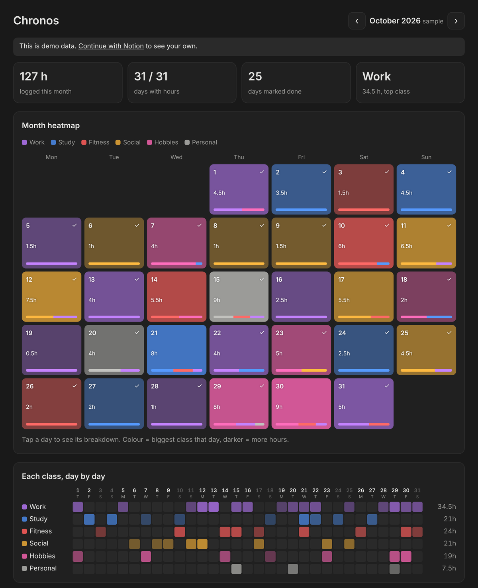
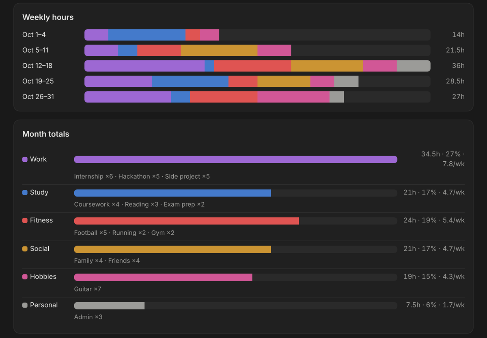
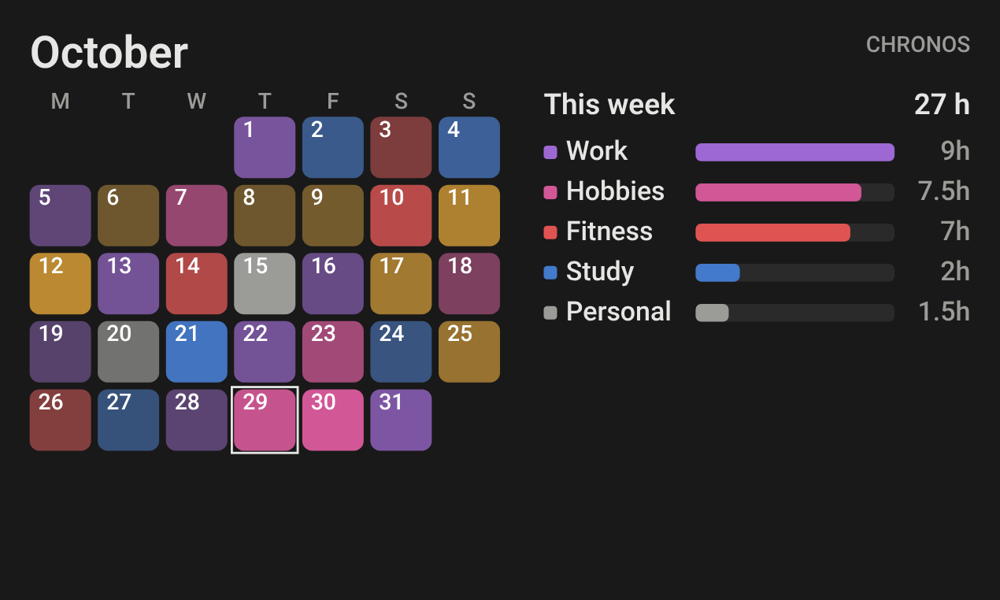
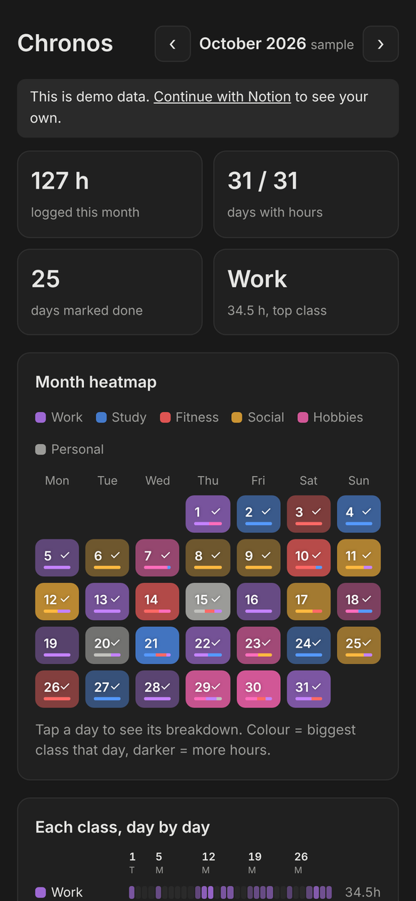

# Chronos

I used to plan my months on paper. I'd print a calendar, scribble a rough plan
in each box, and cross the day off when it was done. It worked, but I couldn't
look back and see where my time actually went. Was it a gym month? Did that
side project really get 30 hours, or did it just feel like it?

So I moved the journal into Notion, and then built Chronos on top of it: a small
dashboard that reads my Notion Journal and turns it into a colour-coded month,
plus a home-screen widget so I see it without opening anything.

**I built this for myself.** It fits how I like to track my days, not every way
people track theirs. It isn't a product and I'm not running it as a service. The
code is here in case it's useful to you, and it's set up so you can run your own
copy for free in about 20 minutes.



*This is the sample month every new Journal starts with, so the dashboard isn't
empty on day one.*

## What it does

- **Month heatmap.** Each day takes the colour of the class I spent the most
  time on, and gets darker the more hours I logged. Finished days get a tick,
  the digital version of crossing them off.
- **Each class, day by day.** One row per class (Work, Study, Fitness…), so
  streaks and gaps are obvious.
- **Weekly and monthly totals**, with the sub-themes inside each class. I can
  start a tag like "Hackathon" for two weeks and drop it afterwards; it still
  rolls up into its class.
- **A 6-month trend** at the bottom.
- **Logging without opening Notion.** Tap a day, tap **+ Add to this day**, set
  hours with −/+ buttons, pick tags, save. It writes straight back to Notion.



## On my phone

I mostly use it from my phone's home screen.

<p>
  
  &nbsp;
  
</p>

- **Install it like an app:** open the site in Chrome, then **⋮ → Add to Home
  screen**. Long-press the icon for **Log today**, **Today in Notion** and
  **This week**.
- **Widget:** the app gives you a private image link (`/widget.svg?key=…`) and a
  ready-made formula for [KWGT](https://play.google.com/store/apps/details?id=org.kustom.widget).
  Paste the formula into a KWGT Image item in **Vector (SVG)** mode and it draws
  this month plus this week's hours, sharp and in your widget's exact shape. It
  refreshes every minute, so a save shows up within a minute. Point the widget's
  tap action at `/log` and tapping it opens today's log. **Reset link** in the
  app kills an old link if it ever leaks.

## How it reads your Notion

Chronos doesn't need a special template. It looks at a Journal database and works
out the fields:

| In Notion | Used for |
|---|---|
| A **date** field (prefers `Date`) | which day an entry belongs to |
| **Number fields ending in ` h`** (`Work h`, `Fitness h`…) | the classes and their hours |
| A **multi-select** (prefers `Did`) | sub-theme tags; a tag's colour decides its class |
| A **checkbox** (prefers `Day done`) | crossed-off days |

If you don't have a Journal yet, Chronos makes one. After you sign in, it asks
which broad classes you want (Work, Study, Fitness, Social, Hobbies and Personal
to start with, all editable), creates the database in your Notion, and fills last
month with sample entries. **Remove demo month** in the menu clears them when
you're ready.

## Run your own

Everything runs on Cloudflare's free plan: one Worker serves the page, handles
"Continue with Notion" and talks to Notion, and a small D1 database stores users
and sessions. Your journal entries are never stored. They're read live from
Notion each time.

You need a free Cloudflare account, Node.js 18+, and a Notion **public
integration** (step 4).

### The quick way (Windows)

```powershell
./setup.ps1
```

It installs dependencies, logs you into Cloudflare, creates the database, deploys,
and asks for your Notion client ID and secret. You still create the Notion
integration yourself (step 4 below).

### By hand

1. **Install and log in**
   ```
   npm install
   npx wrangler login
   ```
2. **Create the database.** Run `npx wrangler d1 create chronos`, copy the
   `database_id` it prints into `wrangler.toml`, then:
   ```
   npx wrangler d1 execute chronos --remote --file schema.sql
   ```
3. **Deploy once** with `npx wrangler deploy` to get your URL
   (`https://chronos.<you>.workers.dev`). Sign-in won't work yet.
4. **Create the Notion integration** at
   [notion.so/profile/integrations](https://www.notion.so/profile/integrations):
   choose **Public**, and use your URL for the website, `YOUR_URL/privacy.html`,
   `YOUR_URL/terms.html`, and the redirect URI `YOUR_URL/oauth/callback`. Turn on
   **Read content**, **Update content**, **Insert content** and **Read user
   information including email addresses**. Copy the OAuth client ID and secret.
5. **Add the secrets**
   ```
   npx wrangler secret put NOTION_CLIENT_ID
   npx wrangler secret put NOTION_CLIENT_SECRET
   node -e "console.log(require('crypto').randomBytes(32).toString('base64'))"
   npx wrangler secret put ENC_KEY
   ```
   `ENC_KEY` is the random value from the `node` line. It encrypts the stored
   Notion tokens. If you change it, everyone just signs in again.
6. **Open your URL** and choose **Continue with Notion**.

To update later, edit the files and run `npx wrangler deploy` again.

### Running locally

Put your own values in `.dev.vars` (it's git-ignored):
```
NOTION_CLIENT_ID=...
NOTION_CLIENT_SECRET=...
ENC_KEY=...
```
Add `http://localhost:8787/oauth/callback` as a second redirect URI in Notion,
then:
```
npx wrangler d1 execute chronos --local --file schema.sql
npx wrangler dev
```
`/?demo` shows the sample month without signing in.

## Privacy and security

- Notion tokens are encrypted (AES-GCM) before they're stored, and never reach
  the browser.
- Sessions are random 256-bit IDs in an HttpOnly, Secure cookie, valid for 30 days.
- Journal entries aren't stored anywhere; they're read from Notion per visit.
- Each person only ever sees their own data. **Delete my account** removes your
  row, and disconnecting Chronos in Notion (Settings → Connections) revokes it
  completely.

## Things I tried that didn't make it

The widget used to have an "instant refresh" that pinged KWGT through Kustom's
remote-message API right after a save. Kustom's shared relay kept answering
`429 Too Many Requests`, even after minutes of no traffic, so I took it out. The
per-minute refresh is good enough for me.
